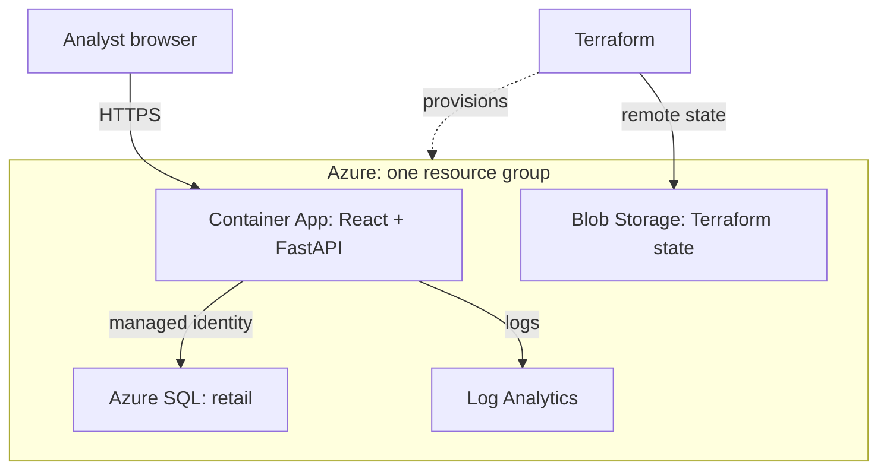

# Retail Decision Intelligence

Retail analytics for understanding customer behavior, merchandise performance,
shopping baskets, and demand. The current foundation provides workspace navigation
and API/database connectivity.

## Development

Requires Python 3.12, Node.js 24, uv 0.13.6, and Make.

```bash
make setup
make local-account
uv run --project backend python -m retail_api.accounts.admin 'you@example.com'  # optional: promote to Administrator
make migrate
make dev-api  # terminal 1
make dev-web  # terminal 2
```

Web: http://localhost:5173 · API docs: http://127.0.0.1:8000/api/v1/docs.

Environments: **local** uses the commands above; **development** deploys from
`main` after CI passes. No staging or production environment is configured.

Rollback: run **Deploy development** from `main` with the previous image reference
shown in the deployment summary. Migrations are not downgraded; the selected image
must support the current database schema.

## Checks

```bash
make check      # contracts, lint, types, tests, build
make format     # format code
make contracts  # regenerate API types after API changes
```

## Customer model training and evaluation

Configure a persistent database in `.env`, run `make migrate`, and import
Households, Products, and Transactions before training.

```bash
# Evaluate both models and print held-out metrics.
uv run --project backend --locked --group ml python -m retail_api.customers.train --dry-run

# Publish evaluations and validated scores.
uv run --project backend --locked --group ml python -m retail_api.customers.train \
  --artifact-dir ../rdi-model-artifacts
```

For Azure, use `--artifact-container-url <private-blob-container-url>` in place
of `--artifact-dir`. Optional flags are `--model clv|churn` and `--as-of YYYY-MM-DD`
(defaults to the latest imported date). Rerun after imports to refresh stale scores.

View published evidence in the signed-in API docs at
`/api/v1/customers/models/{model}/evaluation`.

## Container

```bash
docker build -t rdi .
docker run --rm -p 8000:8000 rdi
python scripts/smoke_deployment.py http://127.0.0.1:8000
```

## Architecture



App, logs, and state: North Central US. SQL: West US 3.
