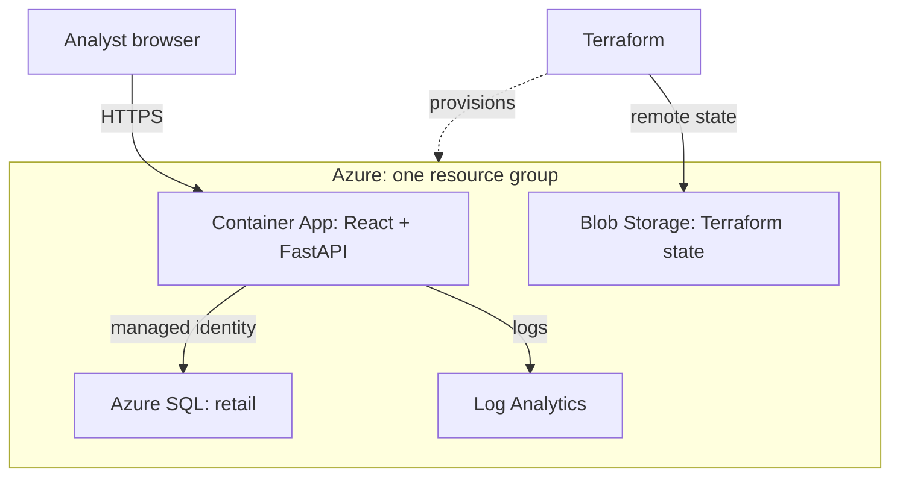

# Retail Decision Intelligence

Retail analytics for understanding customer behavior, merchandise performance,
shopping baskets, and demand. The current foundation provides workspace navigation
and API/database connectivity.

## Development

Requires Python 3.12, Node.js 24, uv 0.13.6, and Make.

```bash
make setup
make local-account
uv run --project backend python -m retail_api.accounts.admin 'you@example.com'  # optional: promote to Administrator
make migrate
make dev-api  # terminal 1
make dev-web  # terminal 2
```

Web: http://localhost:5173 · API docs: http://127.0.0.1:8000/api/v1/docs.

Environments: **local** uses the commands above; **development** deploys from
`main` after CI passes. No staging or production environment is configured.

Rollback: run **Deploy development** from `main` with the previous image reference
shown in the deployment summary. Migrations are not downgraded; the selected image
must support the current database schema.

## Checks

```bash
make check      # contracts, lint, types, tests, build
make format     # format code
make contracts  # regenerate API types after API changes
```

## Customer model training and evaluation

Run from the repository root. Point `.env` at a persistent database, run
`make migrate`, and import Households, Products, and Transactions in Data
Operations. Training uses the same database settings as the API.

```bash
# Evaluate both models and print JSON evidence.
uv run --project backend --locked --group ml python -m retail_api.customers.train --dry-run

# Publish the versioned evaluation and household scores to local SQL.
uv run --project backend --locked --group ml python -m retail_api.customers.train \
  --artifact-dir ../rdi-model-artifacts
```

The default cutoff is the latest imported transaction date. Use
`--model clv` or `--model churn` for a single model and `--as-of YYYY-MM-DD`
for an earlier cutoff. For Azure SQL, run from a host that can reach the
database with an identity that can write the model tables. Supply
`--artifact-container-url https://<account>.blob.core.windows.net/<private-container>`
in place of `--artifact-dir` and use an Azure identity with permission to write
blobs to that container.

Both models use 180 days of purchase history. CLV estimates the next 90 days
of net spend. Churn estimates the probability of zero positive-unit purchases
in the next 60 days. The JSON output reports held-out dates, sample sizes,
candidate and baseline metrics, and uncertainty in the primary metric
improvement. Publication stores scores only when the candidate passes the
validation gates. An import that changes the source data marks scores stale.
Rerun training to refresh them.

After signing in, check `/api/v1/customers/models/clv/evaluation` or
`/api/v1/customers/models/churn/evaluation` in the API docs. The cohort summaries
and paginated household endpoints use the published SQL snapshot.

## Container

```bash
docker build -t rdi .
docker run --rm -p 8000:8000 rdi
python scripts/smoke_deployment.py http://127.0.0.1:8000
```

## Architecture



App, logs, and state: North Central US. SQL: West US 3.
