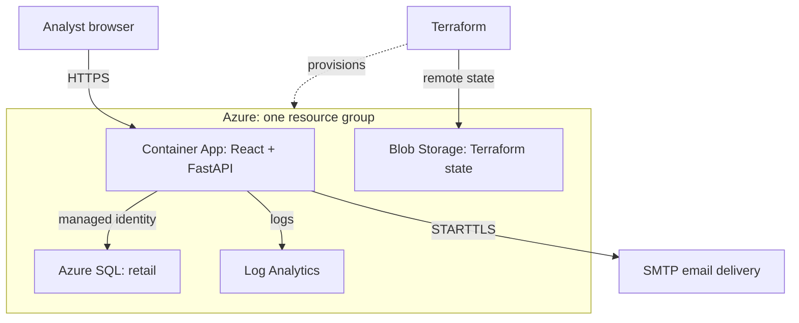

# Retail Decision Intelligence

Retail analytics for understanding customer behavior, merchandise performance,
shopping baskets, and demand. The current foundation provides workspace navigation
and secure account access.

## Development

Requires Python 3.12, Node.js 24, uv 0.13.6, and Make.

```bash
make setup
make dev-api  # terminal 1
make dev-web  # terminal 2
```

Web: http://localhost:5173 · API docs: http://127.0.0.1:8000/api/v1/docs.
Optional local settings: copy `.env.example` to `.env`.
Accounts require a signing key, SMTP settings in `.env`, and `make migrate`.
Development SMTP uses the `ACCOUNT_MAIL` environment secret (JSON matching `account_mail`
in `infra/variables.tf`). Registration and recovery require working email delivery.
Promote an existing verified account explicitly with
`uv run --project backend python -m retail_api.accounts.admin <email>` using operator SQL access.

Environments: **local** uses the commands above; **development** deploys from
`main` after CI passes. No staging or production environment is configured.

Rollback: run **Deploy development** from `main` with the previous image reference
shown in the deployment summary. Migrations are not downgraded; the selected image
must support the current database schema.

## Checks

```bash
make check      # contracts, lint, types, tests, build
make format     # format code
make contracts  # regenerate API types after API changes
```

## Container

```bash
docker build -t rdi .
docker run --rm -p 8000:8000 rdi
python scripts/smoke_deployment.py http://127.0.0.1:8000
```

## Architecture



App, logs, and state: North Central US. SQL: West US 3.
