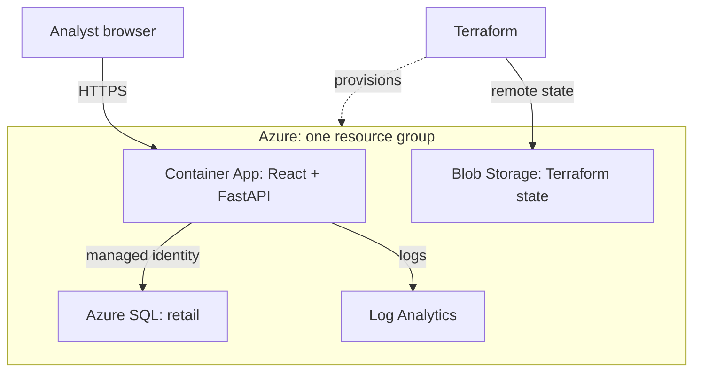

# Retail Decision Intelligence

Retail analytics for understanding customer behavior, merchandise performance,
shopping baskets, and demand. The current foundation provides workspace navigation
and API/database connectivity.

## Development

Requires Python 3.12, Node.js 24, uv 0.13.6, and Make.

```bash
make setup
make local-account
uv run --project backend python -m retail_api.accounts.admin 'you@example.com'  # optional: promote to Administrator
make migrate
make dev-api  # terminal 1
make dev-web  # terminal 2
```

Web: http://localhost:5173 · API docs: http://127.0.0.1:8000/api/v1/docs.

Environments: **local** uses the commands above; **development** deploys from
`main` after CI passes. No staging or production environment is configured.

Rollback: run **Deploy development** from `main` with the previous image reference
shown in the deployment summary. Migrations are not downgraded; the selected image
must support the current database schema.

## Checks

```bash
make check      # contracts, lint, types, tests, build
make format     # format code
make contracts  # regenerate API types after API changes
```

## Customer model training and evaluation

For local training, set the database in the repo-root `.env`:

```dotenv
RDI_DATABASE_URL=sqlite+pysqlite:///./retail.db
```

Use the same SQLite file as the app. Run `make migrate` and import the retail
datasets before training. `make local-account` can set up the database entry
and signing secret when you need to sign in locally.

```bash
# Evaluate both models and print held-out metrics.
uv run --project backend --locked --group ml python -m ml.customer_models.train --dry-run

# Publish evaluations and validated scores.
uv run --project backend --locked --group ml python -m ml.customer_models.train \
  --artifact-dir ../rdi-model-artifacts
```

For Azure SQL, set `RDI_SQL_SERVER=<server>.database.windows.net` and
`RDI_SQL_DATABASE=<database>` instead. For publication, use
`--artifact-container-url <private-blob-container-url>` in place of
`--artifact-dir`.

Use `--model clv` or `--model churn` to train one model. `--as-of YYYY-MM-DD`
defaults to the latest imported date. Rerun after imports to refresh stale scores.

View published evidence in the signed-in API docs at
`/api/v1/customers/models/{model}/evaluation`.

### Runtime hyperparameters

Pass overrides as CLI flags. Each run records the effective values.

| Flag | Default | Controls |
| --- | --- | --- |
| `--clv-loss` | `absolute_error` | Loss function. Also accepts `squared_error`. |
| `--clv-learning-rate` | `0.1` | Boosting step size. |
| `--clv-max-iter` | `80` | Maximum boosting iterations. |
| `--clv-max-leaf-nodes` | `12` | Maximum leaves per tree. |
| `--clv-min-samples-leaf` | `25` | Minimum samples per leaf. |
| `--clv-l2-regularization` | `4.0` | L2 regularization strength. |
| `--clv-random-state` | `42` | Estimator seed. |
| `--churn-max-iter` | `1000` | Solver iteration limit. |
| `--churn-c` | `1.0` | Inverse regularization strength. |
| `--churn-tol` | `0.0001` | Solver convergence tolerance. |
| `--churn-class-weight` | Equal weights | Pass `balanced` to weight classes by inverse frequency. |

## Container

```bash
docker build -t rdi .
docker run --rm -p 8000:8000 rdi
python scripts/smoke_deployment.py http://127.0.0.1:8000
```

## Architecture



App, logs, and state: North Central US. SQL: West US 3.
