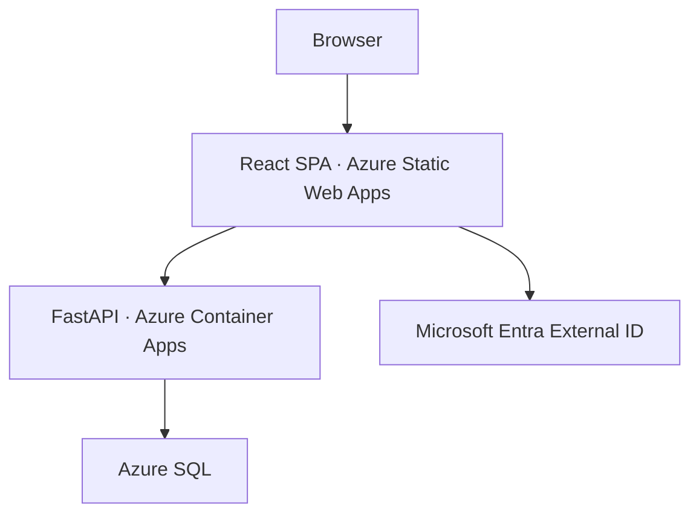

# Retail Decision Intelligence

Retail analytics built with React/TypeScript, FastAPI, and Azure SQL. This first
slice provides the local development foundation: seven workspace routes and a
typed health API. Business screens show an unavailable state until implemented.

## Run locally

Requires Python 3.12, Node.js 24, uv 0.13.6, and Make (Linux, macOS, or WSL).

```bash
make setup
make dev-api  # terminal 1
make dev-web  # terminal 2
```

Open http://localhost:5173. API docs: http://127.0.0.1:8000/api/v1/docs.
Defaults work without configuration; copy `.env.example` to `.env` for overrides.
Only explicit frontend origins are allowed by CORS; Vite proxies `/api` locally.
Never put secrets in a `VITE_` variable or commit `.env`.

## Verify

```bash
make smoke     # install locked dependencies, run all checks, then start/stop real local servers
make check     # contract drift, lint, Python/TypeScript checks, tests, production frontend build
make contracts # after changing an API request or response model
```

FastAPI owns the OpenAPI contract in `backend/openapi.json`. `openapi-typescript`
generates `frontend/src/api/schema.d.ts`; `openapi-fetch` uses it for typed calls.
Commit both generated files with API changes. CI rejects stale contracts.

Local SQL tests use in-memory SQLite through SQLAlchemy. They do not verify Azure
SQL; cloud connectivity belongs to [#3](https://github.com/krispykrits/retail-decision-intelligence/issues/3).
`GET /api/v1/health` reports process liveness, independent of database readiness.

## Structure and deployment

`frontend/` SPA · `backend/` API · `tests/` backend checks · `infra/` Terraform ·
`ml/` offline analysis · `docs/` reserved. The last three directories are empty foundations.



This diagram is the deployment target. Azure provisioning, authentication, and
deployment automation are subsequent stories [#2](https://github.com/krispykrits/retail-decision-intelligence/issues/2),
[#3](https://github.com/krispykrits/retail-decision-intelligence/issues/3),
[#4](https://github.com/krispykrits/retail-decision-intelligence/issues/4), and
[#5](https://github.com/krispykrits/retail-decision-intelligence/issues/5).
No cloud resources or deployment credentials are required by this slice.
